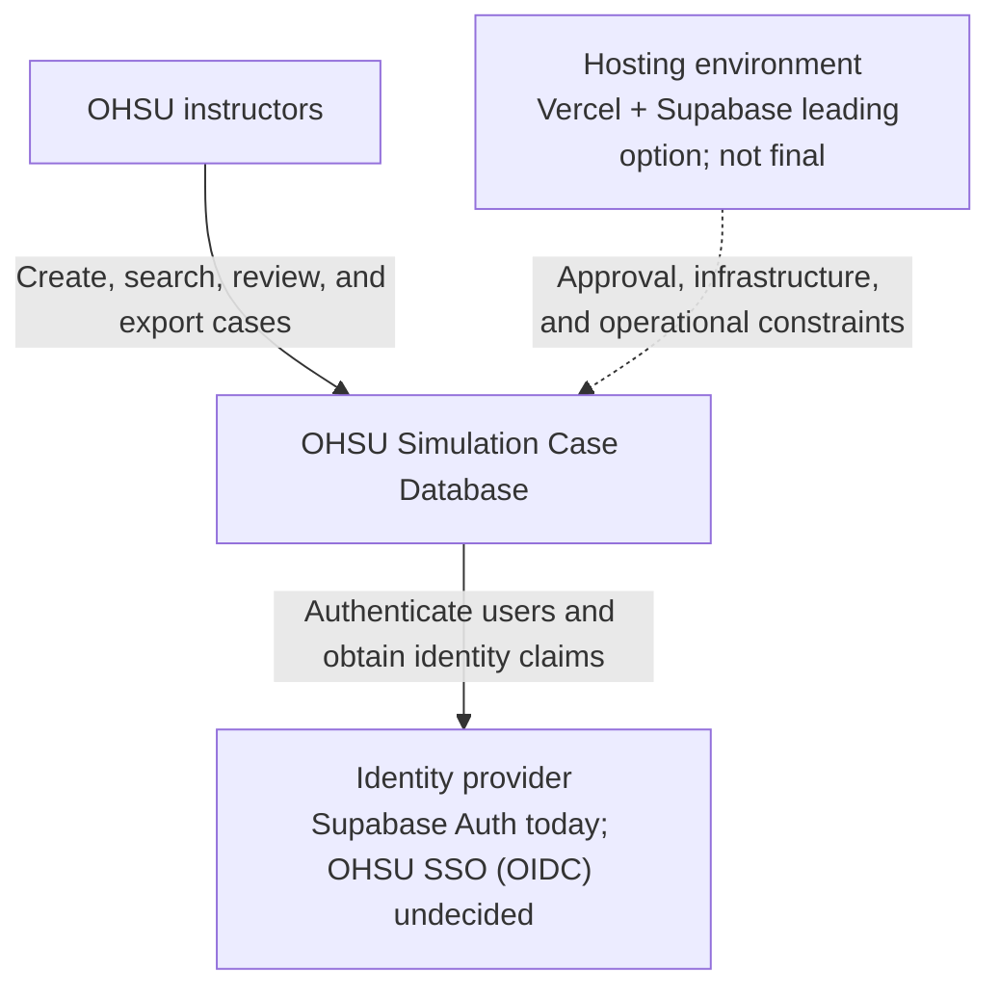
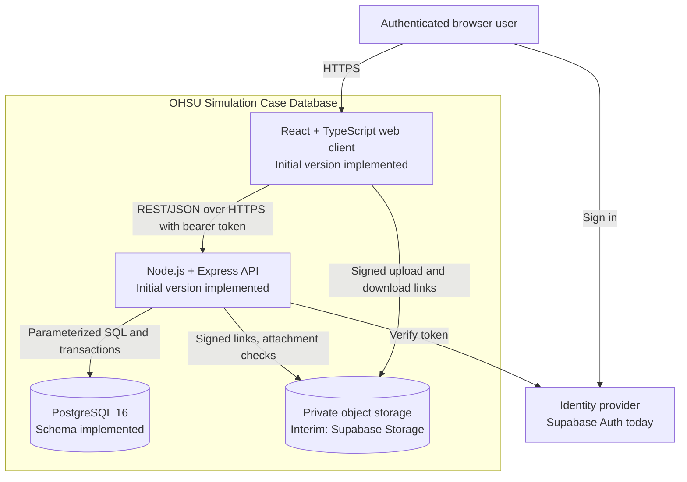

# OHSU Simulation Case Database — System Design

**Status:** Draft  
**Last updated:** 2026-11-17  
**Scope:** Current repository state and the next implementation phase

This document is the shared technical design for the OHSU Simulation Case Database. It distinguishes implemented behavior from planned or pending decisions so that the team does not treat an RFC recommendation as deployed architecture.

| Label | Meaning |
|---|---|
| **Implemented** | Present on `main` and covered by the current repository or CI |
| **Planned** | Required or selected for implementation, but not yet present as application code |
| **Pending** | Requires partner, OHSU IT, or team approval before it becomes a commitment |

## 1. Overview

The system will give OHSU School of Nursing faculty a central place to create, find, review, adapt, and maintain simulation cases across campuses. A case has stable identity and one or more immutable versions. Versions can be tagged, associated with learning outcomes, submitted for peer review, approved, exported, and superseded without erasing earlier history.

The repository currently contains an **implemented PostgreSQL schema, database tests, and CI**, plus an **initial React and TypeScript client** (sign-in page, app shell, New case form, and case listing, search, and details) and an **initial Node.js, Express, and TypeScript API**. Users are OHSU instructors only; student accounts and an Owner/Admin hierarchy are non-goals (see `requirements.md`). Instructors sign in through Supabase Auth with team-provisioned accounts. `vercel.json` deploys the client and API to Vercel.

Hosting and production sign-in are **pending** (requirements OQ-1). The leading option is Vercel for the client and API, with Supabase for the PostgreSQL database, Auth, and file storage. It is not final, and there is no accepted RFC for it. Whether production sign-in must use OHSU single sign-on (OIDC) is also open. The earlier AWS hosting RFC and the S3 storage RFC remain Draft/Proposed recommendations; neither should be described as accepted or implemented.

The first useful release should support the complete path from authenticated case creation through versioning, search, review, and export. It must use synthetic simulation data only; real patient data and personally identifiable learner, faculty, or staff data are outside the system boundary.

## 2. Architecture

### 2.1 C4 Level 1 — System context



The application owns simulation-case content and workflow state. The identity provider owns authentication: Supabase Auth today, with OHSU single sign-on still possible for production. OHSU IT may still constrain which hosting environment and cloud services can be used. Users interact only through the web application; they do not access the database or stored files directly.

### 2.2 C4 Level 2 — Container design



| Container | Responsibility | Current state |
|---|---|---|
| Web client | Accessible user interface, form validation, search, review workflow, and import/export actions | **Partly implemented.** `client/` is a Vite + React + TypeScript app with React Router. A shared layout (`components/Layout.tsx`) provides the header navigation and skip link. It has a New case form (`/new`) and a Cases list (`/cases`) with text search, course/campus/outcome filters kept in the page URL, and loading, error, and empty states. Review, import, and export screens are planned. The front-end RFC metadata is still Draft. |
| API | Authentication, authorization, business rules, transactions, document processing, and all database/file access | **Partly implemented.** `server/` is an Express + TypeScript app with zod input validation and parameterized `pg` queries. Case, lookup, and profile routes require a verified and provisioned instructor; the health check stays public. |
| PostgreSQL | Durable case, version, taxonomy, usage, outcome, and review data | **Implemented.** Schema and database tests run against PostgreSQL 16.15 in CI. |
| Object storage | Private original uploads and generated export artifacts; database stores metadata and object keys | **Interim.** Case attachments (#63) use a private Supabase Storage bucket behind a replaceable interface (§3.3). The S3 RFC is still Proposed, and production storage and retention are unresolved. |
| OHSU OIDC | User authentication and identity claims | **Pending integration details.** The API must still enforce authorization independently of the browser. |

The system begins as a modular monolith: one web client, one API deployment, one relational database, and—if approved—one private object store. Microservices and asynchronous queues are not justified by the current scale or requirements.

## 3. Interfaces and Contracts

### 3.1 HTTP API

The API contract is REST-style JSON under `/api`. Except for the health endpoint (and any login or callback endpoints a future identity flow needs), every route must reject an unauthenticated request with `401`. Authorization is enforced in the API, not by hiding controls in the browser.

The following endpoints are the baseline implementation contract. Before client and server work proceed independently, the team should record exact request/response schemas and examples in `docs/api/openapi.yaml` and review that file together.

| Method and route | Contract |
|---|---|
| `GET /api/health` | Public liveness response; must not expose secrets, configuration, or database contents. |
| `GET /api/cases` | Return title, status, campus use, and last-updated data. Accept course, campus, outcome, and text filters. Pagination must be included before production use. |
| `POST /api/cases` | Create a case and its first draft version in one database transaction. Missing or blank title returns `400` and performs no writes. |
| `GET /api/cases/:caseId` | Return case metadata, current version, version history, mappings, and review summary according to the caller's permissions. |
| `POST /api/cases/:caseId/versions` | Append a new version based on an existing case. Prior versions remain unchanged. |
| `PUT /api/case-versions/:versionId/outcomes` | Replace the version's outcome mappings atomically; reject duplicate or unknown outcomes. |
| `POST /api/case-versions/:versionId/submit` | Move an authorized draft into the submitted-for-review state. Invalid transitions return `409`. |
| `POST /api/case-versions/:versionId/reviews` | Record approve or request-changes, reviewer, comment, and decision time. Who may review, and whether self-review is allowed, is pending (requirements OQ-2). |
| `POST /api/imports/word` | Accept an allowed Word document, create a draft, and return all content that could not be placed automatically. |
| `GET /api/case-versions/:versionId/export?format=docx\|pdf` | Produce or retrieve an authorized export containing every template section in its original order. |

**Implemented so far** (`server/src/app.ts`, `server/src/routes/cases.ts`, `server/src/routes/lookups.ts`). These differ from the target contract above. Every route except `GET /api/health` requires a verified, provisioned instructor (§3.2): a missing or invalid token gets `401`, and an authenticated but unapproved identity gets `403`.

| Route | Current behavior | Gap from the target contract |
|---|---|---|
| `GET /api/health` | Public. Returns `{ "status": "ok" }`. Does not check the database. | None for liveness. A readiness check (§6) is still needed. |
| `GET /api/auth/me` | Returns `{ id }` for the signed-in instructor. | Not in the target contract above; add it when the contract is next reviewed. |
| `GET /api/cases` | Returns an array of `{ id, title, status, updatedAt }`, newest first. `updatedAt` is the current version's creation time. Optional parameters combine with AND: `search` matches the title or any text in the current version's content (case-insensitive); `course` and `campus` (ids) must match the same `case_use` row; `outcome` (id) must be mapped to the current version. A malformed or nonexistent id returns `400` with the offending `fields`. | No campus use in the response, no pagination. |
| `GET /api/cases/:caseId` | See "Initial current-version detail view" below. | No history, mappings, or review summary. |
| `GET /api/courses`, `GET /api/campuses`, `GET /api/outcomes` | Return the campuses, courses, and outcomes that at least one case uses (an outcome only if a case's current version maps to it), sorted, for the Cases page's filter dropdowns (#77). Nobody seeds these tables; the lists grow as cases are saved. | Not in the target contract above; add them when the contract is next reviewed. |
| `/api/cases/:caseId/attachments` (list, upload, download, remove) | See §3.3, Case attachments (#63). | Not in the target contract above; add it when the contract is next reviewed. |
| `POST /api/cases` | Body `{ title, content, campus?, courses?, outcomes? }`, where `campus` is text and `courses` and `outcomes` are lists of text. Creates the case, version 1 with status `draft`, and the current-version pointer in one transaction, then returns `201` with `{ id, versionId }`. In the same transaction (#77) it finds each campus, course, and outcome by name, ignoring capitals and extra spaces, creates any that do not exist, and writes one `case_use` row per course at the campus and one `case_version_outcome` row per outcome; repeats are saved once. Typed courses are stored in `course.code` with no title; typed outcomes are stored under the framework `Case outcomes`. A missing, blank, or over-300-character title returns `400`. So does a campus without a course or a course without a campus, or a blank or over-long entry; those add a `fields` list. | No creator or owner is recorded, because there is no signed-in user. Edits (`POST /api/cases/:caseId/versions`) still only carry the existing links forward and cannot change them. |

Errors currently return `{ "error": "<code>" }` (for example `invalid_request`, `not_found`, `internal_error`). A `400` from `GET /api/cases` adds a `fields` list naming the bad parameters, and a `400` from `POST /api/cases` adds zod's `issues` list. That is simpler than the error envelope below; the two should be reconciled before more routes are added.

JSON errors should use one predictable envelope:

```json
{
  "error": {
    "code": "INVALID_STATE_TRANSITION",
    "message": "Only a draft version can be submitted for review.",
    "details": []
  }
}
```

Use `400` for malformed requests, `401` for missing/invalid authentication, `403` for insufficient permission, `404` for absent or non-visible resources, `409` for state or uniqueness conflicts, and `422` when a structurally valid import cannot satisfy domain validation. The API must not expose stack traces, SQL, storage keys, or access tokens.

### Initial current-version detail view (#48)

`GET /api/cases/:caseId` implements the first part of the planned detail contract:
`{ id, title, currentVersion }`. The version is null when no valid current version
belongs to this case; otherwise it contains `id`, `versionNumber`, `status`,
`createdAt`, and the saved JSON `content`. A malformed positive PostgreSQL INT ID
returns `400`; a missing case returns `404`. The query is read-only and joins the
version by both its ID and case ID. History, mappings, and review summaries remain
unimplemented parts of the full contract above.

The detail page follows the template's section order and labels. It also displays
saved keys outside the current template as additional content. It must not write
back, infer missing values, or remove legacy content. Back to cases preserves the
list URL's search and filters. Blank optional fields may be omitted from display.

The route sits behind the same instructor check as the other case routes. Use
synthetic data only when verifying it.

### Edit and archive a case (#56, #57)

`POST /api/cases/:caseId/versions` saves `{ expectedVersionId, title, changes }`
as a new draft. It preserves the previous version and copies its attachment,
tag, and outcome links. Omitted fields stay as saved. A null field clears it.
Stale edits or attachment changes return `409`.

`PATCH /api/cases/:caseId/archive` toggles the case's archived state with
`{ archived: boolean }`. Approved instructors can archive active drafts and
restore archived cases. Use `GET /api/cases?archived=1` to find archived cases.
They remain readable with their files. Apply `db/migrations/004_case_archive.sql`
before deploying against an existing database.

### Role details in new drafts (#44)

The `roles.participants`, `roles.patientEmbedded`, and `roles.educatorsStaff`
fields now store arrays of `{ "role": "Observers", "detail": "6-10" }`.
Participants use detail for counts/ranges; the other groups use it for a role
description or assignment. A selected role may have an empty detail in a draft.
No real person's name is required. An unchecked role is omitted on submission.
The UI may keep `selected: "false"` locally so rechecking restores typed text;
`selected` is removed before storage. Successful save clears the form and drafts.

Old string-array selections, `participantCounts`, and `patientEmbeddedOther`
are still readable. Existing database content is not migrated or rewritten.
The old shared count is labelled as legacy information, not assigned to individual
roles by guesswork. The separate Other text input is removed only from the new
patient/embedded-role form; its replacement is that role's own detail input.

Per-participant counts follow the partner's draft template. Detail inputs for
every other role are the issue's proposed interpretation, not proof of partner
approval. This change does not claim complete coverage of that draft template.

These are simulation roles inside a case's content (participants, embedded
actors, educators). They are not application user roles.

### 3.2 Authentication and authorization

The server verifies a Supabase Auth bearer token and looks up its stable subject in `app_user.oidc_subject`. A row explicitly provisioned with `role = 'instructor'` is required; sign-in never creates or promotes an application account. See [Instructor access](instructor-access.md) for provisioning and database protection. Whether production sign-in stays on Supabase Auth or moves to OHSU single sign-on (OIDC) is pending (requirements OQ-1).

Every approved instructor has the same application access. An Owner/Admin hierarchy and student accounts are non-goals. Who may review and approve a case, and whether an author may review their own case, is pending (requirements OQ-2). Keep reviewing and approving as separate checks in the API so those rules can be added without restructuring. A user-visible name or email is not a stable identity key. Logs must not contain access tokens, session cookies, full imported documents, or sensitive case content.

### 3.3 Database and file boundaries

Only the API connects to PostgreSQL. Schema changes are made through reviewed, ordered migrations before the application version that depends on them is released. Creating a case and its first version, changing a current-version pointer, and replacing a set of mappings must be transactional.

Buckets remain private and the API authorizes every upload and download. PostgreSQL stores the owning case/version, object key, original filename, media type, size, checksum, uploader, and upload time; binary files do not belong in PostgreSQL.

#### Case attachments (#63)

Decided 2026-11-17 by Logan Moskal (issue assignee) for issue #63. This is an **interim** decision for development and demos on the current Vercel + Supabase deployment; it does not accept the [object-storage RFC](rfcs/2026-10-25-object-storage-for-uploads.md) and does not approve uploading real partner files. The team should confirm it, and the partner and OHSU IT still own the production storage choice (Open Question 4).

| Question | Decision |
|---|---|
| Where files are stored | A **private Supabase Storage bucket** (default `case-files`) in the Supabase project the app already uses. Only the API holds the secret key (`SUPABASE_SECRET_KEY`, or Vercel's `SUPABASE_SERVICE_ROLE_KEY`); the browser only receives one-object signed links. Code reaches storage only through the `FileStorage` interface in `server/src/attachments/storage.ts`, so an S3 adapter can replace it if the RFC is accepted. Moving existing objects would then be a one-time copy keyed by `case_file.storage_key`. |
| Allowed types and size | PDF, Word (`.docx`), PowerPoint (`.pptx`), Excel (`.xlsx`), PNG, and JPEG, **at most 25 MB per file** (under Supabase's free-tier 50 MB per-file cap). Enforced three times: the bucket's own type and size limits (`npm run storage:setup --workspace server`), the API, and `CHECK` constraints on `case_file`. |
| How files are checked | **No malware scanner yet.** There is none available on Vercel or Supabase without adding an outside service, which needs approval (AGENTS.md). Until one exists: the API reads each stored object back and identifies its type from its bytes, not its name or the browser's claim; macro-enabled Office files are refused even when renamed; the stored `Content-Type` must match; and every download is sent as an attachment (`Content-Disposition`), never rendered inline. **Scanning must be in place before real partner files are uploaded.** |
| Ownership | Files belong to **versions**. `case_file` holds one row per stored object and `case_version_file` links it to each version that has it. Composite foreign keys keep a file and its version in the same case. Saving a new version (#56) copies its predecessor's links with `carryForwardAttachments()` in the same transaction. Only the current version, and only while it is a draft, can gain or lose files; other states return `409`. |
| Removing a file | Unlinks it from the current version only. The `case_file` row and the stored object are kept, so older versions still list and download it. Nothing is hard-deleted. |
| Retention | Kept for as long as the case exists. There is no automatic expiry or lifecycle deletion. A retention period is still Open Question 4. |
| Archived cases (#57) | Archiving changes nothing about attachments: they stay stored and downloadable, so restoring a case brings them back unchanged. |
| Failed uploads | A `case_file` row is written only after the stored object passes every check, in the same transaction that links it to the version. If any check or the database write fails, the API deletes the object. If the browser closes between uploading and recording, the object has no row; the next upload request for that case deletes any such object older than one hour. |

Upload flow. Vercel limits request bodies to a few MB, so file bytes never pass through the API:

1. `POST /api/cases/:caseId/attachments/uploads` with `{ filename, sizeBytes }` checks the name, type, and size and that the current version is a draft, then returns `201 { uploadKey, uploadUrl, mediaType, maxBytes }`. Nothing is stored yet.
2. The browser `PUT`s the file to `uploadUrl` with `Content-Type: mediaType`. The link works for one object key and expires after two hours (Supabase's fixed lifetime). The session token is not sent to storage.
3. `POST /api/cases/:caseId/attachments` with `{ uploadKey, filename, sha256 }` (SHA-256 computed in the browser) reads the object back, checks size, type, and checksum, and records it. Returns `201` with the attachment.

Other routes, all behind the instructor check:

- `GET /api/cases/:caseId/attachments[?versionId=]` returns `{ versionId, editable, files: [{ id, filename, mediaType, sizeBytes, sha256, uploadedAt }] }` for the current version, or for any version of the case.
- `GET /api/cases/:caseId/attachments/:fileId/download` returns `{ url, expiresInSeconds: 60 }`, a signed link that downloads the file under its original name.
- `DELETE /api/cases/:caseId/attachments/:fileId` unlinks the file from the current draft version and returns `204`.

Error codes: `unsupported_type`, `file_too_large`, `checksum_mismatch`, `upload_not_found`, `already_attached` (`409`), `version_not_editable` (`409`), `not_found` (`404`), and `storage_unavailable` (`503`, when the secret key isn't configured). Storage keys are random (`cases/<caseId>/<uuid>`) and never derived from the filename. Responses never include storage keys except the one being uploaded.

Word import must normalize recognized sections into the version's `content` document and return an explicit list of unplaced content instead of dropping it. Export must preserve every template section in its defined order. Partner-owned source documents must not be committed to the public repository or sent to unapproved external services.

## 4. Data Design

The implemented schema contains `campus`, `app_user`, `course`, `outcome`, `sim_case`, `case_version`, `tag`, `case_version_tag`, `case_use`, `case_version_outcome`, `review`, `case_file`, and `case_version_file`. Case content is currently stored as JSONB so the template can evolve while stable relational fields remain searchable.

`sim_case` owns the stable case identity and points to a current `case_version`; every version belongs to one case and creator. A case may reference a parent case when it is adapted. Join tables associate versions with tags and outcomes, while `case_use` associates a case with a campus and course. Reviews belong to a version and reviewer. `case_file` records each attached file's metadata for a case, and `case_version_file` links it to the versions that have it (§3.3). `app_user.oidc_subject` is the stable external identity key.

The following invariants apply to application code and should be strengthened in the schema where practical:

- A case requires a nonblank title and a stable owner.
- Each case version number is unique within its case; edits append a version and never mutate an earlier approved version.
- `sim_case.current_version_id` must refer to a version of that same case. The current foreign key checks only that the version exists, so this cross-row invariant still needs enforcement.
- Status, role, and review-decision values require agreed controlled vocabularies. They are currently free text; the API grants access only to the exact role `instructor`.
- Workflow transitions must be explicit and tested; the database does not currently enforce them.
- Version content should be required once the canonical JSON shape is agreed. It is currently nullable.
- The project must choose and document a timezone convention. Existing columns use `TIMESTAMP` without timezone.
- Historical approved/version data must not be hard-deleted. Archival, supersession, retention, and restoration rules are still required.

## 5. Key Runtime Scenarios

The design review should walk one scenario end to end. An authenticated, authorized author creates a case; the API validates it and inserts the case, first draft version, and current-version pointer in one transaction. An edit appends a version and changes the pointer without mutating the earlier version. The author submits the draft, and an authorized reviewer approves or requests changes with a comment and timestamp. Search applies visibility rules before course, campus, outcome, text filters, and pagination. Export rechecks access and renders the requested immutable version; an export failure never changes the case.

Conflicting version numbers or invalid workflow transitions return `409`. Search must return within 10 seconds for 100 cases, and usability testing should confirm that a user can find a known case within 30 seconds.

## 6. Deployment and Operations

### Current environments

| Environment | Design |
|---|---|
| Local development | PostgreSQL 16.15 in Docker or a local PostgreSQL instance. `bash db/test.sh` creates a temporary database, loads the schema, runs SQL tests, and drops it. For the app, the API (`npm run dev --workspace server`, port 3000) reads `DATABASE_URL` and the Supabase Auth settings from `server/.env`, and the Vite client (`npm run dev --workspace client`) reads its Supabase settings from `client/.env` and forwards `/api` to the API. A local Supabase stack can be used for a local-only demo (see [Instructor access](instructor-access.md)). The server's database tests run when `TEST_DATABASE_URL` names a throwaway database ending in `_test`. README.md ("Run the app") has the steps. |
| CI | GitHub Actions scans for secrets and blocked sensitive files, starts PostgreSQL 16.15, and runs database tests. The app job runs `npm ci`, lint, typecheck, test, and build across the `client` and `server` workspaces on Node 22. It does not set `TEST_DATABASE_URL`, so the server's database tests are skipped in CI. |
| Vercel deployment | **Exists; purpose to be confirmed.** `vercel.json` deploys `client/` (Vite) and `server/` (Express) as two Vercel services and routes `/api/*` to the API. A deployment is live at ohsu-simulation-database.vercel.app. Whether it is a shared demo, a staging environment, or the start of production has not been recorded. Use synthetic data only. |
| Staging | **Not formally defined.** Must use synthetic data, a separate identity project, and production-like database/storage controls. |
| Production | **Pending (requirements OQ-1).** The leading option is Vercel + Supabase, but no production topology should be treated as final yet. |

Two hosting options are on record, and neither is accepted:

- **Vercel + Supabase (leading option, no RFC).** Vercel hosts the client and Express API; Supabase hosts PostgreSQL, Auth, and file storage. This matches the existing `vercel.json` and the Supabase Auth integration.
- **AWS (Draft RFC, `docs/rfcs/RFC-Draft-Kenneth_Robertson.md`).** Recommends, conditionally, an AWS container deployment with managed PostgreSQL and private S3 storage, pending OHSU approval.

Whichever host is chosen: the browser must not reach the database directly, and only the API connects to it (on Supabase, with the Data API disabled; see [Instructor access](instructor-access.md)). Encryption is required in transit and at rest, secrets belong in the platform's environment-variable or secret store and never in the repository, and storage must block public access.

Each release should use an immutable application artifact, apply backward-compatible migrations, run a smoke test, and support rollback to the prior application artifact. Database rollback cannot rely only on down-migrations: before a destructive migration, the team must take and test an approved backup/restore path. Health checks should distinguish process liveness from readiness without returning confidential details.

Minimum operational signals are request count, latency, error rate, authentication failures, database connection saturation, import/export failures, and storage failures. Logs should use request/correlation IDs and actor IDs where approved, but must exclude tokens, secrets, document bodies, and unnecessary personal data. Alert ownership and production support expectations remain open.

## 7. Security, Privacy, Accessibility, and Quality

- Use synthetic case data only. Real patient information and identifiable learner/faculty/staff information are prohibited.
- Validate all inputs on the server, use parameterized queries, restrict upload type/size, and never trust browser authorization state.
- Keep secrets and environment files out of source control. The existing CI secret scan remains a required gate.
- All primary workflows must be keyboard operable, expose visible focus, use programmatic labels, meet contrast requirements, and not communicate state by color alone.
- Unit tests cover domain rules; integration tests cover API/database transactions and authorization; end-to-end tests cover create, version, search, submit, review, import, and export.
- CI must pass before merge, and at least one teammate must approve each pull request under the current contribution rules.

## 8. Risk-Reduction Spikes

Each spike is time-boxed and ends with evidence and a recorded decision, not production code by default.

| Risk | Time box and proof | Result to record |
|---|---|---|
| OHSU SSO (OIDC) integration | Only if OHSU requires SSO for production (OQ-1). 2–3 days after test credentials exist. Demonstrate login, logout, callback validation, stable-subject mapping, expired/invalid-token rejection, and `401` on protected routes. | Authentication flow, claim mapping, session/token choice, and local/CI test strategy. |
| Word import fidelity | 2–3 days using approved synthetic copies of both sample templates. Produce normalized JSON and a complete unplaced-content report; no content may disappear silently. | Import library choice, supported document rules, failure handling, and measured limitations. |
| Word/PDF export fidelity | 1–2 days. Export every canonical section in order and compare output against an agreed checklist. | Rendering approach, supported formats, accessibility limits, and acceptance fixture. |
| Hosting topology | 2–3 days once a host is chosen (Vercel + Supabase is the leading option). Deploy a synthetic build, prove the database is reachable only through the API, exercise secrets, collect cost estimates, restore a backup into a separate database, and roll back one release. | Accepted deployment diagram, ownership, recovery evidence, and a decision record. |

## 9. Open Questions

These questions block parts of implementation and should have named owners and decision dates:

1. Will the team and OHSU accept Vercel + Supabase as the host, or is another environment required? Does production sign-in need OHSU single sign-on (OIDC)? Owner: Kenneth (requirements OQ-1).
2. Who may review and approve a case, and can an author review their own case? An Owner/Admin hierarchy and student accounts are non-goals (requirements OQ-2).
3. What are the canonical workflow states, allowed transitions, and visibility rules for drafts, submitted, approved, superseded, archived, and due-for-review cases?
4. Is private S3-compatible object storage accepted for production, replacing the interim Supabase Storage bucket (§3.3)? Which malware-scanning service is approved? What are the retention schedule, restore window, and deletion rules? (Upload types and the 25 MB limit are set for now in §3.3.)
5. What is the canonical JSON schema for case content, and which fields must also be relational and searchable?
6. What are the expected user count, case count beyond the initial 100-case performance target, campuses, concurrent usage, and document sizes?
7. Should timestamps be migrated to `TIMESTAMPTZ`, and how will the current-version/same-case invariant be enforced?
8. Which license applies to the repository and which partner-owned artifacts may be included in code, tests, demos, or external tools?
9. Who owns production alerts, backups, recovery testing, dependency patching, and incident response?

## 10. Deferred Decisions

The team is intentionally deferring microservices, message queues, real-time collaborative editing, a mobile application, AI-generated cases/data entry, migration of all historical cases, independent multi-region deployment, and third-party telemetry. These choices should be revisited only when measured requirements justify their complexity and OHSU has approved the relevant data use.

## 11. Validation and Maintenance

Before implementation begins, the team and partner should review the context/container diagrams, walk through create → version → submit → review → search → export, and identify the behavior when the identity provider, PostgreSQL, object storage, or document conversion is unavailable. A design review is complete only when unresolved issues are captured above with owners and dates.

This is a living document. Any pull request that changes a container boundary, API contract, data relationship, deployment topology, security boundary, or major failure behavior must update this file in the same change. Durable, hard-to-reverse decisions should also update or add a decision record. Longer proposals that compare options go in `docs/rfcs/`; short records of a decision the team has made go in `docs/adr/` (see AGENTS.md, Sources of truth).

## Repository Evidence Used

- [`README.md`](../README.md) — project purpose, current status, stack, and local app/CI workflow.
- [`server/src/`](../server/src/) and [`client/src/`](../client/src/) — implemented API routes and client pages.
- [`vercel.json`](../vercel.json) — Vercel services for the client and API.
- [`docs/requirements.md`](requirements.md) — functional requirements, constraints, performance targets, success metrics, non-goals, and open questions.
- [`docs/instructor-access.md`](instructor-access.md) — instructor provisioning and hosted Supabase checks.
- [`db/schema.sql`](../db/schema.sql), [`db/migrations/`](../db/migrations/), and [`db/tests/`](../db/tests/) — implemented data model, migrations, and verified database behavior.
- [`.github/workflows/ci.yml`](../.github/workflows/ci.yml) and [`CONTRIBUTING.md`](../CONTRIBUTING.md) — existing quality gates and review process.
- [`docs/rfcs/`](rfcs/) — PostgreSQL decision and draft/proposed front-end, storage, and hosting recommendations.
- [`docs/adr/`](adr/) — short decision records, including team-provisioned instructor access.
- [`AGENTS.md`](../AGENTS.md) — domain, privacy, security, accessibility, data-integrity, and testing guardrails.