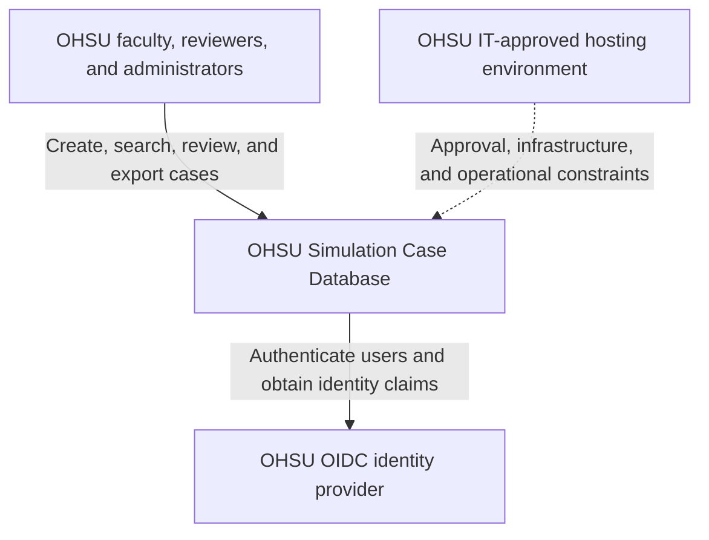
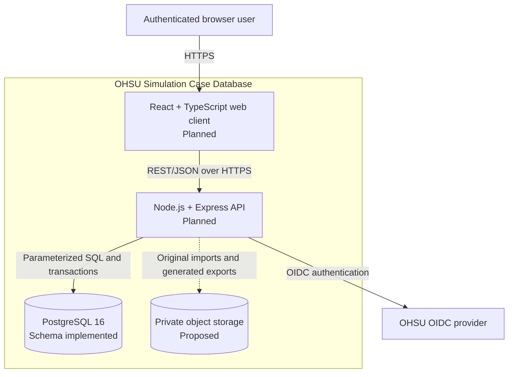

# OHSU Simulation Case Database — System Design

**Status:** Draft  
**Last updated:** 2026-10-28  
**Scope:** Current repository state and the next implementation phase

This document is the shared technical design for the OHSU Simulation Case Database. It distinguishes implemented behavior from planned or pending decisions so that the team does not treat an RFC recommendation as deployed architecture.

| Label | Meaning |
|---|---|
| **Implemented** | Present on `main` and covered by the current repository or CI |
| **Planned** | Required or selected for implementation, but not yet present as application code |
| **Pending** | Requires partner, OHSU IT, or team approval before it becomes a commitment |

## 1. Overview

The system will give OHSU School of Nursing faculty a central place to create, find, review, adapt, and maintain simulation cases across campuses. A case has stable identity and one or more immutable versions. Versions can be tagged, associated with learning outcomes, submitted for peer review, approved, exported, and superseded without erasing earlier history.

The repository currently contains an **implemented PostgreSQL schema, database tests, and CI**, but no web application. The intended application stack is a **planned React and TypeScript client** with a **planned Node.js, Express, and TypeScript API**. Authentication must use OHSU OpenID Connect (OIDC). The exact identity-provider configuration and production hosting remain **pending OHSU IT approval**. Private S3-compatible object storage and an AWS deployment have RFC recommendations, but neither should be described as accepted or implemented yet.

The first useful release should support the complete path from authenticated case creation through versioning, search, review, and export. It must use synthetic simulation data only; real patient data and personally identifiable learner, faculty, or staff data are outside the system boundary.

## 2. Architecture

### 2.1 C4 Level 1 — System context



The application owns simulation-case content and workflow state. OHSU's identity provider owns authentication. OHSU IT controls which hosting environment and cloud services may be used. Users interact only through the web application; they do not access the database or stored files directly.

### 2.2 C4 Level 2 — Container design



| Container | Responsibility | Current state |
|---|---|---|
| Web client | Accessible user interface, form validation, search, review workflow, and import/export actions | **Planned.** React and TypeScript are project constraints; the front-end RFC metadata is still Draft. |
| API | Authentication, authorization, business rules, transactions, document processing, and all database/file access | **Planned.** No application `package.json` or API code exists yet. |
| PostgreSQL | Durable case, version, taxonomy, usage, outcome, and review data | **Implemented.** Schema and database tests run against PostgreSQL 16.15 in CI. |
| Object storage | Private original uploads and generated export artifacts; database stores metadata and object keys | **Pending.** The S3 RFC is Proposed and retention rules are unresolved. |
| OHSU OIDC | User authentication and identity claims | **Pending integration details.** The API must still enforce authorization independently of the browser. |

The system begins as a modular monolith: one web client, one API deployment, one relational database, and—if approved—one private object store. Microservices and asynchronous queues are not justified by the current scale or requirements.

## 3. Interfaces and Contracts

### 3.1 HTTP API

The API contract is REST-style JSON under `/api`. Except for the health endpoint and the OIDC login/callback endpoints required by the selected flow, every route must reject an unauthenticated request with `401`. Authorization is enforced in the API, not by hiding controls in the browser.

The following endpoints are the baseline implementation contract. Before client and server work proceed independently, the team should record exact request/response schemas and examples in `docs/api/openapi.yaml` and review that file together.

| Method and route | Contract |
|---|---|
| `GET /health` | Public liveness response; must not expose secrets, configuration, or database contents. |
| `GET /api/cases` | Return title, status, campus use, and last-updated data. Accept course, campus, outcome, and text filters. Pagination must be included before production use. |
| `POST /api/cases` | Create a case and its first draft version in one database transaction. Missing or blank title returns `400` and performs no writes. |
| `GET /api/cases/:caseId` | Return case metadata, current version, version history, mappings, and review summary according to the caller's permissions. |
| `POST /api/cases/:caseId/versions` | Append a new version based on an existing case. Prior versions remain unchanged. |
| `PUT /api/case-versions/:versionId/outcomes` | Replace the version's outcome mappings atomically; reject duplicate or unknown outcomes. |
| `POST /api/case-versions/:versionId/submit` | Move an authorized draft into the submitted-for-review state. Invalid transitions return `409`. |
| `POST /api/case-versions/:versionId/reviews` | Record approve or request-changes, reviewer, comment, and decision time. Role and self-review rules are pending. |
| `POST /api/imports/word` | Accept an allowed Word document, create a draft, and return all content that could not be placed automatically. |
| `GET /api/case-versions/:versionId/export?format=docx\|pdf` | Produce or retrieve an authorized export containing every template section in its original order. |

JSON errors should use one predictable envelope:

```json
{
  "error": {
    "code": "INVALID_STATE_TRANSITION",
    "message": "Only a draft version can be submitted for review.",
    "details": []
  }
}
```

Use `400` for malformed requests, `401` for missing/invalid authentication, `403` for insufficient permission, `404` for absent or non-visible resources, `409` for state or uniqueness conflicts, and `422` when a structurally valid import cannot satisfy domain validation. The API must not expose stack traces, SQL, storage keys, or OIDC tokens.

### 3.2 Authentication and authorization

The server validates the OIDC session or token, maps the stable OIDC subject to `app_user.oidc_subject`, and applies a default-deny authorization policy. The exact browser flow—server session cookie versus bearer token—must be decided by the OIDC spike and OHSU guidance. Until the team agrees on a role/permission matrix, free-text roles in the current schema are not an authorization specification.

At minimum, the authorization design must distinguish creating/editing, reviewing, approving, and administration. A user-visible name or email is not a stable identity key. Logs must not contain access tokens, session cookies, full imported documents, or sensitive case content.

### 3.3 Database and file boundaries

Only the API connects to PostgreSQL. Schema changes are made through reviewed, ordered migrations before the application version that depends on them is released. Creating a case and its first version, changing a current-version pointer, and replacing a set of mappings must be transactional.

If object storage is accepted, buckets remain private and the API authorizes every upload and download. PostgreSQL stores the owning case/version, object key, original filename, media type, size, checksum, creator, and timestamps; binary files do not belong in PostgreSQL. The storage metadata table, allowed file types and sizes, malware-scanning approach, retention period, and deletion behavior must be decided before uploads are enabled.

Word import must normalize recognized sections into the version's `content` document and return an explicit list of unplaced content instead of dropping it. Export must preserve every template section in its defined order. Partner-owned source documents must not be committed to the public repository or sent to unapproved external services.

## 4. Data Design

The implemented schema contains `campus`, `app_user`, `course`, `outcome`, `sim_case`, `case_version`, `tag`, `case_version_tag`, `case_use`, `case_version_outcome`, and `review`. Case content is currently stored as JSONB so the template can evolve while stable relational fields remain searchable.

`sim_case` owns the stable case identity and points to a current `case_version`; every version belongs to one case and creator. A case may reference a parent case when it is adapted. Join tables associate versions with tags and outcomes, while `case_use` associates a case with a campus and course. Reviews belong to a version and reviewer. `app_user.oidc_subject` is the stable external identity key.

The following invariants apply to application code and should be strengthened in the schema where practical:

- A case requires a nonblank title and a stable owner.
- Each case version number is unique within its case; edits append a version and never mutate an earlier approved version.
- `sim_case.current_version_id` must refer to a version of that same case. The current foreign key checks only that the version exists, so this cross-row invariant still needs enforcement.
- Status, role, and review-decision values require agreed controlled vocabularies. They are currently free text.
- Workflow transitions must be explicit and tested; the database does not currently enforce them.
- Version content should be required once the canonical JSON shape is agreed. It is currently nullable.
- The project must choose and document a timezone convention. Existing columns use `TIMESTAMP` without timezone.
- Historical approved/version data must not be hard-deleted. Archival, supersession, retention, and restoration rules are still required.

## 5. Key Runtime Scenarios

The design review should walk one scenario end to end. An authenticated, authorized author creates a case; the API validates it and inserts the case, first draft version, and current-version pointer in one transaction. An edit appends a version and changes the pointer without mutating the earlier version. The author submits the draft, and an authorized reviewer approves or requests changes with a comment and timestamp. Search applies visibility rules before course, campus, outcome, text filters, and pagination. Export rechecks access and renders the requested immutable version; an export failure never changes the case.

Conflicting version numbers or invalid workflow transitions return `409`. Search must return within 10 seconds for 100 cases, and usability testing should confirm that a user can find a known case within 30 seconds.

## 6. Deployment and Operations

### Current environments

| Environment | Design |
|---|---|
| Local development | PostgreSQL 16.15 in Docker or a local PostgreSQL instance. `bash db/test.sh` creates a temporary database, loads the schema, runs SQL tests, and drops it. |
| CI | GitHub Actions scans for secrets and blocked sensitive files, starts PostgreSQL 16.15, and runs database tests. An application job is already defined and will run install, lint, typecheck, test, and build after a root `package.json` exists. |
| Staging | **Not yet implemented.** Must use synthetic data, the approved identity-provider test configuration, and production-like database/storage controls. |
| Production | **Pending OHSU IT approval.** No production topology should be treated as final yet. |

The current hosting RFC recommends, conditionally, an AWS container deployment with managed PostgreSQL and private S3 storage. That topology is a candidate, not an accepted fact. If approved, the web/API service should run in private-by-default networking, PostgreSQL must not be publicly reachable, encryption is required in transit and at rest, secrets belong in the approved secret manager, and storage must block public access.

Each release should use an immutable application artifact, apply backward-compatible migrations, run a smoke test, and support rollback to the prior application artifact. Database rollback cannot rely only on down-migrations: before a destructive migration, the team must take and test an approved backup/restore path. Health checks should distinguish process liveness from readiness without returning confidential details.

Minimum operational signals are request count, latency, error rate, authentication failures, database connection saturation, import/export failures, and storage failures. Logs should use request/correlation IDs and actor IDs where approved, but must exclude tokens, secrets, document bodies, and unnecessary personal data. Alert ownership and production support expectations remain open.

## 7. Security, Privacy, Accessibility, and Quality

- Use synthetic case data only. Real patient information and identifiable learner/faculty/staff information are prohibited.
- Validate all inputs on the server, use parameterized queries, restrict upload type/size, and never trust browser authorization state.
- Keep secrets and environment files out of source control. The existing CI secret scan remains a required gate.
- All primary workflows must be keyboard operable, expose visible focus, use programmatic labels, meet contrast requirements, and not communicate state by color alone.
- Unit tests cover domain rules; integration tests cover API/database transactions and authorization; end-to-end tests cover create, version, search, submit, review, import, and export.
- CI must pass before merge, and at least one teammate must approve each pull request under the current contribution rules.

## 8. Risk-Reduction Spikes

Each spike is time-boxed and ends with evidence and a recorded decision, not production code by default.

| Risk | Time box and proof | Result to record |
|---|---|---|
| OHSU OIDC integration | 2–3 days after test credentials exist. Demonstrate login, logout, callback validation, stable-subject mapping, expired/invalid-token rejection, and `401` on protected routes. | Authentication flow, claim mapping, session/token choice, and local/CI test strategy. |
| Word import fidelity | 2–3 days using approved synthetic copies of both sample templates. Produce normalized JSON and a complete unplaced-content report; no content may disappear silently. | Import library choice, supported document rules, failure handling, and measured limitations. |
| Word/PDF export fidelity | 1–2 days. Export every canonical section in order and compare output against an agreed checklist. | Rendering approach, supported formats, accessibility limits, and acceptance fixture. |
| Approved AWS topology | 2–3 days only after OHSU approval. Deploy a synthetic build, prove private database/storage access, exercise secrets, collect cost estimates, and roll back one release. | Accepted deployment diagram, ownership, recovery evidence, and an ADR/RFC status change. |

## 9. Open Questions

These questions block parts of implementation and should have named owners and decision dates:

1. Which hosting account, cloud services, region, network, and OIDC provider/configuration will OHSU approve?
2. What are the exact roles and permissions for authors, owners, reviewers, approvers, and administrators? Can a user review their own case?
3. What are the canonical workflow states, allowed transitions, and visibility rules for drafts, submitted, approved, superseded, archived, and due-for-review cases?
4. Is private S3-compatible object storage accepted? What are the upload limits, retention schedule, restore window, and deletion rules?
5. What is the canonical JSON schema for case content, and which fields must also be relational and searchable?
6. What are the expected user count, case count beyond the initial 100-case performance target, campuses, concurrent usage, and document sizes?
7. Should timestamps be migrated to `TIMESTAMPTZ`, and how will the current-version/same-case invariant be enforced?
8. Which license applies to the repository and which partner-owned artifacts may be included in code, tests, demos, or external tools?
9. Who owns production alerts, backups, recovery testing, dependency patching, and incident response?

## 10. Deferred Decisions

The team is intentionally deferring microservices, message queues, real-time collaborative editing, a mobile application, AI-generated cases/data entry, migration of all historical cases, independent multi-region deployment, and third-party telemetry. These choices should be revisited only when measured requirements justify their complexity and OHSU has approved the relevant data use.

## 11. Validation and Maintenance

Before implementation begins, the team and partner should review the context/container diagrams, walk through create → version → submit → review → search → export, and identify the behavior when OIDC, PostgreSQL, object storage, or document conversion is unavailable. A design review is complete only when unresolved issues are captured above with owners and dates.

This is a living document. Any pull request that changes a container boundary, API contract, data relationship, deployment topology, security boundary, or major failure behavior must update this file in the same change. Durable, hard-to-reverse decisions should also update or add a decision record. Current records live in `docs/rfcs/`; the team should standardize whether future accepted decisions belong there or under `docs/adr/` before creating both structures.

## Repository Evidence Used

- [`README.md`](../README.md) — project purpose, current status, planned stack, and local/CI workflow.
- [`docs/requirements.md`](requirements.md) — functional requirements, constraints, performance targets, success metrics, non-goals, and open questions.
- [`db/schema.sql`](../db/schema.sql) and [`db/tests/`](../db/tests/) — implemented data model and verified database behavior.
- [`.github/workflows/ci.yml`](../.github/workflows/ci.yml) and [`CONTRIBUTING.md`](../CONTRIBUTING.md) — existing quality gates and review process.
- [`docs/rfcs/`](rfcs/) — PostgreSQL decision and draft/proposed front-end, storage, and hosting recommendations.
- [`AGENTS.md`](../AGENTS.md) — domain, privacy, security, accessibility, data-integrity, and testing guardrails.
